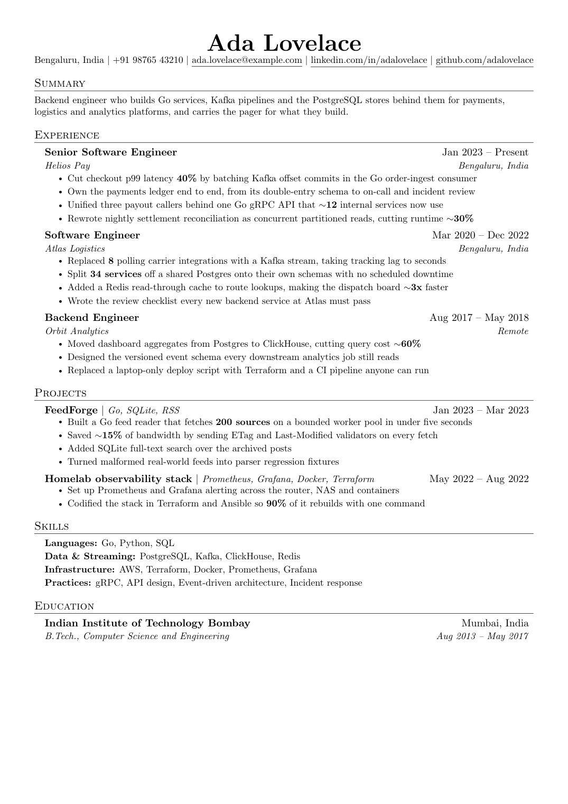

<div align="center">


**Paste in a job posting and get back a one-page résumé tailored to it, plus a list of what the
posting asked for that your history couldn't back up.**

</div>

You describe your work once, in an interview. For each application, auto-apply scores every piece
of that evidence against the posting, picks what fits on one page, writes it as one-line bullets
and compiles a LaTeX PDF. Every bullet cites the record it came from, and the build fails on any
figure you never gave it.

It runs inside [Claude Code](https://claude.com/claude-code) as three slash commands over plain
Markdown files. No account and no database.

<div align="center">

<br><sub>Built from the synthetic test bank in <code>tests/fixtures/bank</code>.</sub>
</div>

## Requirements

- Python 3.10+
- pdfLaTeX, from [TinyTeX](https://yihui.org/tinytex/) or TeX Live. With TinyTeX, also run
  `tlmgr install titlesec marvosym enumitem fancyhdr preprint babel-english`
- git
- [Claude Code](https://claude.com/claude-code)

## Install

```bash
git clone https://github.com/saurabhhbansal/auto-apply.git
cd auto-apply
python3 -m venv .venv
.venv/bin/pip install -r requirements.txt

git -C bank init && git -C runs init      # private history for your data, no remote
cp templates/profile.example.md bank/profile.md
```

Fill in `bank/profile.md`: name, contact details and education. The comments in the file explain
each field. Then check it:

```bash
.venv/bin/python tools/bankcheck.py
```

## Use

**1. Fill the bank:** run `/ingest` in Claude Code and point it at one job or project: a repo, a
design doc, notes or an old résumé. It reads the source, then interviews you about what you
owned, what changed and what the numbers were. It writes `bank/jobs/<name>.md` or
`bank/projects/<name>.md` as you go. Do one job or project per session; three or four entries
are enough to start.

**2. Tailor:** put the posting in a run folder and run `/tailor`.

```bash
mkdir -p runs/acme-backend
$EDITOR runs/acme-backend/jd.md      # paste the full posting
```

You get `runs/acme-backend/resume.pdf` and `runs/acme-backend/gaps.md`. The gap report lists
what the posting wanted that your bank had nothing for, or too little to claim, or that didn't
fit on the page. That tells you what to ingest next. The run only stops to ask when it can't
decide for you.

**3. Audit (occasionally):** `/bank-audit` lists thin entries and the gaps that keep recurring
across runs. It never changes anything.

## Layout

| Path | What |
|---|---|
| `bank/profile.md` | Name, contact details, education. Written by hand. |
| `bank/jobs/`, `bank/projects/` | One Markdown file per job or project, written by `/ingest`. |
| `runs/<name>/` | One application: `jd.md` in, `resume.pdf` and `gaps.md` out, plus the working files (`scores.md`, `allocation.md`, `bullets.md`) that explain each choice. |
| `templates/resume.tex.j2` | The LaTeX template, a fork of [Jake's Resume](https://github.com/jakegut/resume). |
| `tools/` | Bank parsing, page packing, rendering and checks. |
| `.claude/skills/` | The three commands. |
| `docs/adr/` | One record per design decision. Start with [0057](docs/adr/0057-the-page-reads-like-a-resume.md). |

`bank/` and `runs/` are ignored by this repo and keep their own local git history, so nothing
personal goes out with a `git push`.

## Changing the template

The page budget is measured against the template. After changing spacing, margins or font
size, re-measure and copy any changed constants into `tools/config.py`
([docs/calibration.md](docs/calibration.md)):

```bash
.venv/bin/python tests/calibration/probe.py
```

## Tests

```bash
.venv/bin/pip install -r requirements-dev.txt
.venv/bin/pytest
```

Tests that compile a PDF skip themselves when `pdflatex` isn't installed.

## License

[MIT](LICENSE). The résumé template is derived from Jake Gutierrez's MIT-licensed
[Jake's Resume](https://github.com/jakegut/resume).
